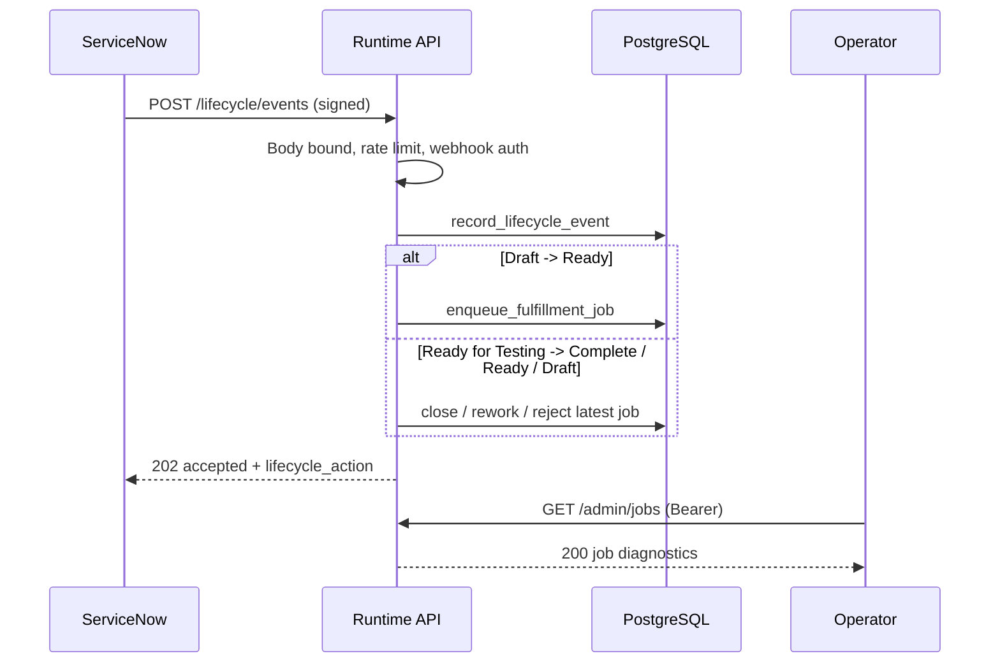

# API Reference

HTTP surface of the JEDI DevProject sidecar runtime. The runtime is a FastAPI application
(`Jedi DevProject Lifecycle API`, version `0.2.0`) built by the
`jedi_devproject.runtime_api:build_app` factory and served with uvicorn:

```bash
uvicorn jedi_devproject.runtime_api:build_app --factory --host 0.0.0.0 --port ${PORT:-8000}
```

All examples below use `http://localhost:8000` as the base URL. Set `PORT` to change the listen
port. The API role is refused at startup when `JEDI_RUNTIME_ROLE=worker`.

## Endpoint Groups

| Group | Endpoints | Auth | Purpose |
|---|---|---|---|
| Public | `GET /health`, `GET /ready` | None | Liveness and readiness probes |
| Lifecycle webhook | `POST /lifecycle/events` | Shared secret or HMAC-SHA256 (fail-closed) | Ingest ServiceNow `rm_story` lifecycle events |
| Admin JSON | `GET /admin/lifecycle-events`, `GET /admin/jobs`, `GET /admin/alerts`, `GET /admin/operations`, `GET /jobs/{job_id}/artifacts`, `GET /jobs/{job_id}/events`, `GET /artifacts/{artifact_id}` | Bearer token (`JEDI_ADMIN_API_TOKEN`) | Operator diagnostics over JSON |
| Admin HTML console | `GET /admin`, `GET /admin/artifacts/{artifact_id}` | Basic auth (`dev_basic`, development-only) | Read-only browser console |



## Cross-Cutting Behavior

### Rate Limits

Two independent in-memory sliding-window limiters, configured by environment variable:

| Limiter | Applies to | Bucket key | Env vars (default) |
|---|---|---|---|
| Lifecycle | `POST /lifecycle/events` | `<client host>:<path>` | `JEDI_LIFECYCLE_RATE_LIMIT_MAX_REQUESTS` (60), `JEDI_LIFECYCLE_RATE_LIMIT_WINDOW_SECONDS` (60), `JEDI_LIFECYCLE_RATE_LIMIT_MAX_BUCKETS` (10000) |
| Admin | All `/admin/*`, `/jobs/*`, `/artifacts/*` endpoints | Per-endpoint group (`jobs`, `alerts`, `artifacts`, ...) | `JEDI_ADMIN_RATE_LIMIT_MAX_REQUESTS` (120), `JEDI_ADMIN_RATE_LIMIT_WINDOW_SECONDS` (60), `JEDI_ADMIN_RATE_LIMIT_MAX_BUCKETS` (10000) |

- Exceeded limit returns `429` with a `Retry-After` header (seconds).
- Admin rate limits are checked **before** authentication, so unauthenticated floods are also throttled.
- A limiter returning a malformed decision fails closed with `503`.
- When the bucket cap is reached, new keys share a `rate-limit-overflow` bucket; keys that are non-ASCII, overlong, or contain whitespace are SHA-256 hashed before bucketing.

### Request Body Limits

| Surface | Env var | Default | Production maximum | Over-limit response |
|---|---|---|---|---|
| Lifecycle webhook | `JEDI_LIFECYCLE_WEBHOOK_MAX_BODY_BYTES` | 65536 | 1048576 | `413` |
| Admin paths (`/admin`, `/jobs/`, `/artifacts/`) | `JEDI_ADMIN_MAX_BODY_BYTES` | 8192 | 65536 | `413` |

Admin body limits are enforced by middleware on both the declared `Content-Length` and the
streamed body.

### Response Headers

Applied to every response:

- `X-JEDI-Request-ID`: echoes the inbound `X-Request-ID` when it is 1-128 characters of
  ASCII alphanumerics, `-`, `_`, or `.`; otherwise a new UUID.
- `X-Content-Type-Options: nosniff`.
- `Strict-Transport-Security: max-age=<JEDI_STRICT_TRANSPORT_SECURITY_MAX_AGE_SECONDS>; includeSubDomains`
  when `JEDI_STRICT_TRANSPORT_SECURITY_ENABLED=true` (required in production for public roles).

Admin diagnostic paths (`/admin*`, `/jobs/*`, `/artifacts/*`) additionally receive
`Cache-Control: no-store`, `Pragma: no-cache`, `Expires: 0`,
`X-Robots-Tag: noindex, nofollow, noarchive`, and `Vary: Authorization`.

Admin HTML pages additionally receive a restrictive `Content-Security-Policy`
(`default-src 'none'` with only inline styles allowed), `X-Frame-Options: DENY`,
`Referrer-Policy: no-referrer`, and a deny-all `Permissions-Policy`.

When `JEDI_TRUSTED_HOSTS` is set, Starlette `TrustedHostMiddleware` rejects requests whose
`Host` header is outside the allowlist with `400`. Production public roles must configure it.

### Validation Error Redaction

Request validation errors return `422` with the Pydantic error list, but the failing input
value is stripped (`hide_input_in_errors`) so submitted secrets and payloads are not reflected
back. Diagnostic strings in admin responses are redacted, whitespace-normalized, and truncated
at 4096 characters with a `...[truncated]` marker.

---

## Public Endpoints

### `GET /health`

Liveness probe. No authentication, no rate limit, no store access.

**Response `200`**

```json
{"status": "ok"}
```

```bash
curl -s http://localhost:8000/health
```

### `GET /ready`

Readiness probe. Verifies the PostgreSQL operational store is reachable and the schema is
migrated. No authentication.

**Response `200`** — store reachable and schema present:

```json
{"status": "ready", "checks": [{"name": "operational_store", "status": "ok"}]}
```

**Response `503`** — store unreachable, or schema missing:

```json
{"status": "unready", "checks": [{"name": "operational_store", "status": "failed"}]}
```

```json
{"status": "unready", "checks": [{"name": "operational_store_schema", "status": "missing"}]}
```

```bash
curl -s -o /dev/null -w "%{http_code}\n" http://localhost:8000/ready
```

---

## Lifecycle Webhook

### `POST /lifecycle/events`

Receives a ServiceNow `rm_story` state-change event, records it, and plans the lifecycle
action. This endpoint is **fail-closed**: it returns `503` until webhook authentication is
configured.

**Rate limit:** lifecycle limiter (default 60 requests per 60 seconds per client host).

**Body limit:** `JEDI_LIFECYCLE_WEBHOOK_MAX_BODY_BYTES` (default 64 KiB).

#### Authentication

`JEDI_LIFECYCLE_WEBHOOK_AUTH_MODE` selects the mode:

| Mode | Status | Behavior |
|---|---|---|
| `disabled` | Default | `503` — endpoint refuses all requests |
| `shared_secret` | Implemented | Constant-time comparison of `X-JEDI-Webhook-Secret` against the configured secret |
| `hmac_sha256` | Implemented (required in production) | Signature + timestamp verification, see below |
| `servicenow_oauth` | Reserved | `501` — not implemented |

`JEDI_LIFECYCLE_WEBHOOK_SECRET` holds the active secret. `JEDI_LIFECYCLE_WEBHOOK_PREVIOUS_SECRET`
may hold the prior secret during rotation; both are accepted, and they must differ. In
production the secret must be 32+ characters with no whitespace or control characters.

**`shared_secret` mode** — send one header:

```text
X-JEDI-Webhook-Secret: <secret>
```

**`hmac_sha256` mode** — send two headers:

```text
X-JEDI-Webhook-Timestamp: <unix seconds, digits only>
X-JEDI-Webhook-Signature: sha256=<hex HMAC-SHA256 of "{timestamp}.{raw body}" keyed by the secret>
```

The ServiceNow-style base64 form `sha256-base64=<base64 HMAC digest>` is also accepted.
The timestamp must be within `JEDI_LIFECYCLE_WEBHOOK_MAX_SKEW_SECONDS` (default 300, production
maximum 900) of server time; outside the window the request is rejected as a replay risk.

#### Request Body

JSON object validated against `LifecycleStateChangeEvent` (extra fields are forbidden; all
text fields must be non-empty after validation):

| Field | Type | Required | Description |
|---|---|---|---|
| `event_id` | string | yes | Unique event identifier; used as the idempotency key |
| `event_type` | string | yes | Must be `"story_state_changed"` |
| `source` | string | yes | Emitting system identifier |
| `table` | string | yes | Source table; lifecycle planning only acts on `rm_story` |
| `story_number` | string | yes | ServiceNow story number (for example `STRY0010001`) |
| `story_sys_id` | string \| null | no | ServiceNow `sys_id` of the story |
| `previous_state` | string | yes | Story state before the transition |
| `current_state` | string | yes | Story state after the transition |
| `occurred_at` | string (ISO 8601 datetime) | yes | When the transition occurred |
| `correlation_id` | string | yes | Correlation ID propagated to jobs, artifacts, and diagnostics |
| `emitted_by` | string | yes | Identity of the emitter |

#### Response `202 Accepted`

| Field | Type | Description |
|---|---|---|
| `accepted` | boolean | Always `true` on a `202` |
| `event_id` | string | Echo of the accepted event ID |
| `story_number` | string | Echo of the story number |
| `should_evaluate` | boolean | `true` when a fulfillment job was enqueued |
| `lifecycle_action` | string \| null | `evaluate_story`, `close_story`, `rework_requested`, `story_rejected`, or `null` |
| `job_id` | string \| null | Enqueued or affected fulfillment job, when applicable |
| `reasons` | string[] | Planning reasons; `["unsupported_lifecycle_transition"]` when no action applies |

Lifecycle planning acts only on `story_state_changed` events for table `rm_story`:

| Transition | `lifecycle_action` | Side effect |
|---|---|---|
| `Draft` → `Ready` | `evaluate_story` | Enqueue a fulfillment job |
| `Ready for Testing` → `Complete` | `close_story` | Close the latest job; notify ServiceNow completion |
| `Ready for Testing` → `Ready` | `rework_requested` | Mark the latest job for rework |
| `Ready for Testing` → `Draft` | `story_rejected` | Reject the latest job; emit a rejected-job alert when configured |
| Anything else | `null` | Recorded only; `reasons` contains `unsupported_lifecycle_transition` |

#### Status Codes

| Code | Condition |
|---|---|
| `202` | Event validated, recorded, and planned |
| `401` | Missing secret/signature headers, malformed timestamp, or timestamp outside the replay window |
| `403` | Secret or signature did not match, or credential shape was rejected |
| `413` | Body exceeded `JEDI_LIFECYCLE_WEBHOOK_MAX_BODY_BYTES` |
| `422` | Body is not valid JSON, contains non-finite numbers, or fails schema validation |
| `429` | Rate limit exceeded (`Retry-After` header included) |
| `501` | `JEDI_LIFECYCLE_WEBHOOK_AUTH_MODE=servicenow_oauth` (reserved) |
| `503` | Auth disabled, secret not configured or invalid, or rate limiter invalid (fail-closed) |

#### Examples

Shared-secret mode:

```bash
curl -s -X POST http://localhost:8000/lifecycle/events \
  -H "Content-Type: application/json" \
  -H "X-JEDI-Webhook-Secret: $JEDI_LIFECYCLE_WEBHOOK_SECRET" \
  -d '{
    "event_id": "evt-01HZY8K0EXAMPLE",
    "event_type": "story_state_changed",
    "source": "servicenow-dev",
    "table": "rm_story",
    "story_number": "STRY0010001",
    "story_sys_id": "9f8b2c3a1b204c01d3e5f6078b4bcb2a",
    "previous_state": "Draft",
    "current_state": "Ready",
    "occurred_at": "2026-08-10T00:00:00Z",
    "correlation_id": "corr-01HZY8K1EXAMPLE",
    "emitted_by": "servicenow.flow.jedi_lifecycle"
  }'
```

HMAC-SHA256 mode (signature computed over `"<timestamp>.<raw body>"`):

```bash
BODY='{"event_id":"evt-01HZY8K0EXAMPLE","event_type":"story_state_changed","source":"servicenow-dev","table":"rm_story","story_number":"STRY0010001","previous_state":"Draft","current_state":"Ready","occurred_at":"2026-08-10T00:00:00Z","correlation_id":"corr-01HZY8K1EXAMPLE","emitted_by":"servicenow.flow.jedi_lifecycle"}'
TS=$(date +%s)
SIG="sha256=$(printf '%s.%s' "$TS" "$BODY" | openssl dgst -sha256 -hmac "$JEDI_LIFECYCLE_WEBHOOK_SECRET" | awk '{print $NF}')"
curl -s -X POST http://localhost:8000/lifecycle/events \
  -H "Content-Type: application/json" \
  -H "X-JEDI-Webhook-Timestamp: $TS" \
  -H "X-JEDI-Webhook-Signature: $SIG" \
  -d "$BODY"
```

Example `202` response for a `Draft` → `Ready` transition:

```json
{
  "accepted": true,
  "event_id": "evt-01HZY8K0EXAMPLE",
  "story_number": "STRY0010001",
  "should_evaluate": true,
  "lifecycle_action": "evaluate_story",
  "job_id": "job-01HZY8K2EXAMPLE",
  "reasons": []
}
```

---

## Admin JSON API

Read-only operator diagnostics. Every endpoint in this group requires:

```text
Authorization: Bearer <JEDI_ADMIN_API_TOKEN>
```

**Fail-closed behavior:**

- `JEDI_ADMIN_API_TOKEN` unset or invalid → `503` (`admin artifact API is not configured`).
- Missing header or wrong scheme → `401` (`admin bearer token required`).
- Token mismatch or malformed token → `403` (`admin bearer token rejected`).
- Comparison is constant-time (`secrets.compare_digest`).

**Rate limit:** admin limiter (default 120 requests per 60 seconds), bucketed per endpoint
group, checked before authentication. Exceeded → `429` with `Retry-After`.

**Common status codes:** `401`, `403`, `429`, `503` as above; `404` for unknown job or
artifact IDs; endpoint-specific codes listed per route.

In production, the token must be at least 32 ASCII characters with no whitespace or control
characters.

### `GET /admin/lifecycle-events`

Recent lifecycle events, most recent first.

**Query parameters**

| Name | Type | Default | Description |
|---|---|---|---|
| `limit` | integer | 50 | Maximum events returned; clamped to 100. Non-positive or non-integer → `422` |

**Response `200`**

```json
{
  "events": [
    {
      "event_id": "evt-01HZY8K0EXAMPLE",
      "event_type": "story_state_changed",
      "story_number": "STRY0010001",
      "correlation_id": "corr-01HZY8K1EXAMPLE",
      "received_at": "2026-08-10T00:00:01Z",
      "validation_status": "accepted"
    }
  ]
}
```

```bash
curl -s http://localhost:8000/admin/lifecycle-events?limit=10 \
  -H "Authorization: Bearer $JEDI_ADMIN_API_TOKEN"
```

### `GET /admin/jobs`

Recent fulfillment jobs, most recent first.

**Query parameters:** `limit` — same semantics as `/admin/lifecycle-events`.

**Response `200`**

```json
{
  "jobs": [
    {
      "job_id": "job-01HZY8K2EXAMPLE",
      "event_id": "evt-01HZY8K0EXAMPLE",
      "story_number": "STRY0010001",
      "status": "queued",
      "attempt_count": 0,
      "created_at": "2026-08-10T00:00:01Z",
      "updated_at": "2026-08-10T00:00:01Z",
      "locked_by": null,
      "locked_at": null,
      "correlation_id": "corr-01HZY8K1EXAMPLE",
      "last_error": null
    }
  ]
}
```

`status` is one of `queued`, `running`, `completed`, `failed`, `rejected`. `last_error` is
redacted and truncated. Timestamps are ISO 8601; UTC is rendered with a `Z` suffix.

```bash
curl -s http://localhost:8000/admin/jobs?limit=25 \
  -H "Authorization: Bearer $JEDI_ADMIN_API_TOKEN"
```

### `GET /admin/alerts`

Operational alerts derived from recent jobs. A job produces an alert when it is `failed`,
`rejected`, or `running` without an update for more than
`JEDI_RUNNING_JOB_STALE_AFTER_SECONDS` (default 3600, production maximum 86400).

**Query parameters:** `limit` — same semantics as `/admin/lifecycle-events`; the limit bounds
the jobs scanned for alerts.

**Response `200`**

```json
{
  "alerts": [
    {
      "alert_id": "job-01HZY8K2EXAMPLE:failed",
      "severity": "critical",
      "job_id": "job-01HZY8K2EXAMPLE",
      "event_id": "evt-01HZY8K0EXAMPLE",
      "story_number": "STRY0010001",
      "correlation_id": "corr-01HZY8K1EXAMPLE",
      "status": "failed",
      "attempt_count": 3,
      "updated_at": "2026-08-10T00:05:00Z",
      "summary": "Fulfillment job failed",
      "detail": "provider call timed out",
      "operator_action": "Inspect job events and ServiceNow work notes"
    }
  ]
}
```

| Alert kind | Severity | Summary | Operator action |
|---|---|---|---|
| `failed` | `critical` | `Fulfillment job failed` | Inspect job events and ServiceNow work notes |
| `rejected` | `warning` | `Fulfillment job requires review` | Inspect job events and ServiceNow work notes |
| `running_stale` | `warning` | `Fulfillment job appears stale` | Inspect worker logs before retrying or restarting work |

```bash
curl -s http://localhost:8000/admin/alerts \
  -H "Authorization: Bearer $JEDI_ADMIN_API_TOKEN"
```

### `GET /admin/operations`

Aggregate fulfillment job status counts.

**Response `200`**

```json
{
  "fulfillment_jobs": {
    "queued": 2,
    "running": 1,
    "completed": 40,
    "failed": 1,
    "rejected": 0,
    "stale_running": 0,
    "total": 44
  },
  "running_job_stale_after_seconds": 3600
}
```

`stale_running` counts `running` jobs not updated within `running_job_stale_after_seconds`.

```bash
curl -s http://localhost:8000/admin/operations \
  -H "Authorization: Bearer $JEDI_ADMIN_API_TOKEN"
```

### `GET /jobs/{job_id}/artifacts`

Artifact references for one fulfillment job.

**Path parameters:** `job_id` — 1-256 printable ASCII characters without leading/trailing
whitespace; otherwise `400` (`invalid job id`). Unknown job → `404` (`job not found`).

**Response `200`**

```json
{
  "job_id": "job-01HZY8K2EXAMPLE",
  "event_id": "evt-01HZY8K0EXAMPLE",
  "story_number": "STRY0010001",
  "correlation_id": "corr-01HZY8K1EXAMPLE",
  "artifacts": [
    {
      "id": 7,
      "job_id": "job-01HZY8K2EXAMPLE",
      "artifact_kind": "implementation_packet",
      "path": "artifacts/STRY0010001/packet.json",
      "sha256": "9f2c...ab01",
      "artifact_id": 12,
      "created_at": "2026-08-10T00:01:00Z"
    }
  ]
}
```

`artifact_id` is the database blob ID usable with `GET /artifacts/{artifact_id}`; it is `null`
when the artifact exists only as a filesystem reference.

```bash
curl -s http://localhost:8000/jobs/job-01HZY8K2EXAMPLE/artifacts \
  -H "Authorization: Bearer $JEDI_ADMIN_API_TOKEN"
```

### `GET /jobs/{job_id}/events`

Status history for one fulfillment job. Same `job_id` validation and `404` behavior as above.

**Response `200`**

```json
{
  "job_id": "job-01HZY8K2EXAMPLE",
  "event_id": "evt-01HZY8K0EXAMPLE",
  "story_number": "STRY0010001",
  "correlation_id": "corr-01HZY8K1EXAMPLE",
  "events": [
    {
      "id": 31,
      "job_id": "job-01HZY8K2EXAMPLE",
      "status": "running",
      "message": "claimed by worker jedi-devproject-worker",
      "created_at": "2026-08-10T00:00:30Z"
    }
  ]
}
```

`message` is redacted and truncated at 4096 characters.

```bash
curl -s http://localhost:8000/jobs/job-01HZY8K2EXAMPLE/events \
  -H "Authorization: Bearer $JEDI_ADMIN_API_TOKEN"
```

### `GET /artifacts/{artifact_id}`

Full artifact blob, including the redacted payload.

**Path parameters:** `artifact_id` — integer database ID. Unknown ID → `404`
(`artifact not found`).

**Response `200`**

```json
{
  "id": 12,
  "job_id": "job-01HZY8K2EXAMPLE",
  "event_id": "evt-01HZY8K0EXAMPLE",
  "story_number": "STRY0010001",
  "correlation_id": "corr-01HZY8K1EXAMPLE",
  "artifact_kind": "implementation_packet",
  "schema_version": "1.0",
  "sha256": "9f2c...ab01",
  "created_at": "2026-08-10T00:01:00Z",
  "payload": {"story_number": "STRY0010001", "...": "..."}
}
```

**Payload safety controls** applied before the payload is returned:

- Keys matching sensitive names are replaced with `***REDACTED***`.
- Nesting is bounded at depth 32; deeper containers render as `"[max depth exceeded]"` and
  circular references as `"[circular reference]"`.
- Collections are capped at 100 items; omitted items are summarized with a
  `{"truncated": true, "omitted_items": N}` marker.
- Payloads whose JSON form exceeds 16384 characters are replaced with a bounded
  `diagnostic_preview` object, and the response gains `"payload_truncated": true`.
- Non-JSON values render as `"[non-json value]"`; non-finite floats are rejected outright.

```bash
curl -s http://localhost:8000/artifacts/12 \
  -H "Authorization: Bearer $JEDI_ADMIN_API_TOKEN"
```

---

## Admin HTML Console

Read-only browser console. ServiceNow remains the user work surface; these pages exist for
operator inspection only.

### Authentication

`JEDI_ADMIN_AUTH_MODE` controls browser access, independent of the JSON bearer token:

| Mode | Behavior |
|---|---|
| `disabled` (default) | `503` — console unavailable |
| `dev_basic` | HTTP Basic auth against `JEDI_ADMIN_CONSOLE_USERNAME` / `JEDI_ADMIN_CONSOLE_PASSWORD`; **requires `JEDI_ENVIRONMENT=development`** |
| `oidc`, `servicenow_oauth` | `501` — reserved, not implemented |

Failure responses fail closed: `503` when the mode is disabled, the environment is not
`development`, or credentials are missing/invalid; `401` with
`WWW-Authenticate: Basic realm="jedi-admin"` when credentials are absent or wrong
(constant-time comparison). In production, console usernames and passwords are rejected at
startup for public runtime roles; use the bearer-protected JSON API instead.

The admin rate limiter applies to console routes as well (`admin-console` and
`admin-console-artifacts` buckets).

### `GET /admin`

Console landing page rendering the 25 most recent fulfillment jobs (with artifact links),
the 25 most recent lifecycle events, and current operational alerts.

**Response `200`** — `text/html`. **Auth failures** — `401`/`503` as above.

```bash
curl -s -u "$JEDI_ADMIN_CONSOLE_USERNAME:$JEDI_ADMIN_CONSOLE_PASSWORD" \
  http://localhost:8000/admin -o admin.html
```

### `GET /admin/artifacts/{artifact_id}`

HTML detail page for one artifact blob: kind, story, job, schema version, created timestamp,
SHA-256, and the redacted payload rendered as formatted JSON. The same payload redaction and
bounding rules as `GET /artifacts/{artifact_id}` apply.

**Response `200`** — `text/html`. Unknown artifact → `404`.

```bash
curl -s -u "$JEDI_ADMIN_CONSOLE_USERNAME:$JEDI_ADMIN_CONSOLE_PASSWORD" \
  http://localhost:8000/admin/artifacts/12 -o artifact.html
```

---

## Status Code Summary

| Code | Meaning in this API |
|---|---|
| `200` | Successful GET |
| `202` | Lifecycle event accepted for processing |
| `400` | Invalid `job_id` path parameter; `Host` header outside `JEDI_TRUSTED_HOSTS` |
| `401` | Authentication material missing or malformed (bearer, webhook secret/signature, console Basic) |
| `403` | Authentication material present but rejected |
| `404` | Job or artifact not found |
| `413` | Request body exceeded the configured limit |
| `422` | JSON/schema validation failure (input values redacted) |
| `429` | Rate limit exceeded; honor `Retry-After` |
| `501` | Reserved auth mode selected (`servicenow_oauth`, `oidc`) |
| `503` | Fail-closed: auth not configured, readiness check failed, or a guard subsystem is invalid |

## Related Configuration

See `docs/admin-auth-config.md` for admin auth mode strategy, and
`docs/system-architecture.md` for the runtime components behind these endpoints. All
environment variables referenced here are parsed and validated in
`src/jedi_devproject/runtime_config.py`; production deployments must additionally satisfy the
production validation rules documented there (HMAC webhook auth, trusted hosts, HSTS, token
strength).
