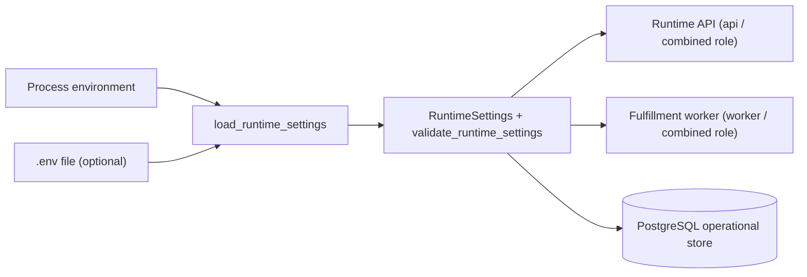

# Configuration Reference

Complete reference for every environment variable consumed by the JEDI DevProject runtime. The
authoritative parser and validator is `src/jedi_devproject/runtime_config.py`; the template is
`.env.example`. For runtime architecture and component responsibilities, see
`docs/system-architecture.md`. For operator procedures, see `docs/operator-guide.md`.

## How Configuration Is Loaded

`load_runtime_settings()` builds the effective configuration in two steps:

1. Read the process environment (`os.environ`).
2. If an `.env` path is supplied, parse it and overlay its values on top of the process
   environment. Values in `.env` win over inherited process values.

Validation is fail-closed: any missing required setting or malformed value raises
`RuntimeConfigError` and the process refuses to start. Production deployments
(`JEDI_ENVIRONMENT=production`) trigger an additional validation pass
(`validate_runtime_settings()`) that enforces the hardening rules called out in each section
below and summarized in [Production Validation Summary](#production-validation-summary).

The runtime never logs secret values. Settings marked **Secret** must be injected through the
platform secret store and must never be committed; `.env` is excluded from the Docker build
context and from git.



## Value Parsing Rules

- **Booleans** accept `true/false`, `1/0`, `yes/no`, or `on/off` (case-insensitive). Any other
  value is a startup error.
- **Enums** must match an allowed value exactly; unrecognized values are a startup error.
- **CSV lists** are comma-separated. Empty items (`a,,b`) are a startup error.
- **Integers** must be base-10. **Floats** must be finite ASCII decimal numbers.
- Strings must not carry leading/trailing padding, whitespace, or control characters unless
  noted otherwise.
- All numeric bounds documented as "production maximum" are enforced only when
  `JEDI_ENVIRONMENT=production`; positive-value checks documented per variable apply in every
  environment when the variable is set.

## Minimal Configurations

Local development (dry-run by default):

```bash
SERVICENOW_INSTANCE_URL=https://<instance>.service-now.com
SERVICENOW_CLIENT_ID=<oauth client id>
SERVICENOW_CLIENT_SECRET=<oauth client secret>
DATABASE_URL=postgresql://jedi:<password>@localhost:5432/jedi
JEDI_AUDIT_ROOT=/absolute/path/to/artifacts/audit
```

Production split topology (see `docs/system-architecture.md` → Deployment Topology):

```bash
# API service
JEDI_ENVIRONMENT=production
JEDI_RUNTIME_ROLE=api
JEDI_TRUSTED_HOSTS=jedi-api.example.mil
JEDI_STRICT_TRANSPORT_SECURITY_ENABLED=true
JEDI_LIFECYCLE_WEBHOOK_AUTH_MODE=hmac_sha256
JEDI_LIFECYCLE_WEBHOOK_SECRET=<random secret, at least 32 characters>
JEDI_ADMIN_API_TOKEN=<random token, at least 32 characters>

# Worker service
JEDI_ENVIRONMENT=production
JEDI_RUNTIME_ROLE=worker
JEDI_MODEL_PROVIDER=openai
OPENAI_API_KEY=<approved provider key>
OPENAI_MODEL=<approved model name>

# Both services
SERVICENOW_PM_INSTANCE_URL=https://<pm-instance>.service-now.com
SERVICENOW_PM_CLIENT_ID=<pm oauth client id>
SERVICENOW_PM_CLIENT_SECRET=<pm oauth client secret>
SERVICENOW_DEV_INSTANCE_URL=https://<dev-instance>.service-now.com
SERVICENOW_DEV_CLIENT_ID=<dev oauth client id>
SERVICENOW_DEV_CLIENT_SECRET=<dev oauth client secret>
DATABASE_URL=postgresql://jedi:<password>@<host>:5432/jedi
JEDI_AUDIT_ROOT=/absolute/path/to/artifacts/audit
```

## ServiceNow

Runtime ServiceNow access is split by responsibility (see `docs/system-architecture.md` →
Split ServiceNow Instances): the **PM/source instance** owns story retrieval and story
writeback; the **DEV/target instance** owns development context and reviewed Update Set import.

| Variable | Required | Default | Allowed values | Used by |
|---|---|---|---|---|
| `SERVICENOW_PM_INSTANCE_URL` | Yes, or legacy fallback | — | HTTPS URL, no credentials, fragments, whitespace, or control characters | Worker (story read/writeback client) |
| `SERVICENOW_PM_CLIENT_ID` | Yes, or legacy fallback | — | Non-empty, unpadded, control-character-free string | Worker |
| `SERVICENOW_PM_CLIENT_SECRET` | Yes, or legacy fallback | — | Non-empty, unpadded, control-character-free string. **Secret.** | Worker |
| `SERVICENOW_DEV_INSTANCE_URL` | Yes, or legacy fallback | — | HTTPS URL, same constraints as PM URL | Worker (context discovery, Update Set import) |
| `SERVICENOW_DEV_CLIENT_ID` | Yes, or legacy fallback | — | Non-empty, unpadded, control-character-free string | Worker |
| `SERVICENOW_DEV_CLIENT_SECRET` | Yes, or legacy fallback | — | Non-empty, unpadded, control-character-free string. **Secret.** | Worker |
| `SERVICENOW_INSTANCE_URL` | Conditional | — | HTTPS URL, same constraints | Legacy single-instance fallback for both PM and DEV URL |
| `SERVICENOW_CLIENT_ID` | Conditional | — | Non-empty string | Legacy fallback for both client IDs |
| `SERVICENOW_CLIENT_SECRET` | Conditional | — | Non-empty string. **Secret.** | Legacy fallback for both client secrets |

Security and behavior notes:

- The legacy `SERVICENOW_*` triple is used only when the corresponding PM/DEV split value is
  absent. Set either the full PM+DEV split or the legacy triple for a single-instance
  deployment.
- A split variable that is present but empty is a startup error; remove the variable entirely
  to fall back to the legacy value.
- Use OAuth 2.0 client credentials registered per instance. Apply least privilege: read-only
  for MVP ingestion tables unless a later phase receives explicit write authorization.
- Prefer the split configuration in production so PM writeback and DEV discovery credentials
  can be rotated and scoped independently.

## Database And Audit Storage

| Variable | Required | Default | Allowed values | Used by |
|---|---|---|---|---|
| `DATABASE_URL` | Yes | — | `postgresql://` or `postgres://` URL with a hostname; no fragments, whitespace, control characters, or encoded whitespace/control characters | API and worker (operational store) |
| `JEDI_POSTGRES_PASSWORD` | Yes for docker compose | — | Any non-empty string. **Secret.** | docker compose local PostgreSQL only |
| `JEDI_AUDIT_ROOT` | Yes | — | Absolute filesystem path without whitespace or control characters | Worker (audit artifacts, intake feedback markers) and CLI tools |

Security and behavior notes:

- `DATABASE_URL` embeds the database password; treat it as a secret and inject it through the
  platform secret store.
- `JEDI_POSTGRES_PASSWORD` is read only by `docker-compose.yml` to set `POSTGRES_PASSWORD` and
  to compose the local `DATABASE_URL`. The Python runtime never reads it. It is not needed for
  externally managed PostgreSQL.
- `JEDI_AUDIT_ROOT` must be absolute in every environment. Point it at durable,
  access-controlled storage; audit artifacts are retained after failures for root-cause
  analysis and must follow agency/customer retention rules.

## Runtime Roles And API Hardening

| Variable | Required | Default | Allowed values | Used by |
|---|---|---|---|---|
| `JEDI_ENVIRONMENT` | No | `development` | `development`, `production` (case-insensitive) | API and worker |
| `JEDI_RUNTIME_ROLE` | No | `combined` | `combined`, `api`, `worker` | API and worker |
| `JEDI_WORKER_ID` | No | `jedi-devproject-worker` | Non-empty, unpadded, control-character-free string | Worker (job claim ownership, audit actor id) |
| `JEDI_ALLOW_COMBINED_PRODUCTION` | Conditional | `false` | Boolean | Runtime validation |
| `JEDI_TRUSTED_HOSTS` | Production api/combined | — (empty) | CSV of hostnames or `*.` wildcard subdomains, optional `:port` | API (Host header allowlist) |
| `JEDI_STRICT_TRANSPORT_SECURITY_ENABLED` | Production api/combined | `false` | Boolean | API (HSTS response header) |
| `JEDI_STRICT_TRANSPORT_SECURITY_MAX_AGE_SECONDS` | No | `31536000` | Positive integer; production minimum `31536000` | API |
| `JEDI_RUNNING_JOB_STALE_AFTER_SECONDS` | No | `3600` | Positive integer; production maximum `86400` | API (admin job staleness detection) |

Security and behavior notes:

- `JEDI_ENVIRONMENT=production` activates the full hardening validation pass. Keep
  `development` for local and PDI work only.
- Prefer split `api`/`worker` services in production. `combined` in production requires
  `JEDI_ALLOW_COMBINED_PRODUCTION=true` as an explicit exception; that flag is rejected with
  any other role.
- Role isolation in production: model provider, OpenAI, public web, build claim, and update
  set settings are worker-only (rejected on the `api` role); lifecycle webhook, trusted hosts,
  and admin auth settings are api-only (rejected on the `worker` role).
- `JEDI_TRUSTED_HOSTS` entries must be public hostnames; `*`, localhost, private/loopback
  addresses, schemes, paths, and unsafe delimiters (`/`, `\`, `@`, `#`, `?`) are rejected.
- Set `JEDI_STRICT_TRANSPORT_SECURITY_ENABLED=true` only after HTTPS is final in front of the
  API; browsers honor HSTS immediately and irreversibly for the max-age window.
- `JEDI_WORKER_ID` must be unique per worker replica so row-level job claims and audit actor
  attribution stay unambiguous.

## Worker Fulfillment Gates

All settings in this section are worker-only and are dry-run by default.

| Variable | Required | Default | Allowed values | Used by |
|---|---|---|---|---|
| `JEDI_BUILD_CLAIM_APPLY` | No | `false` | Boolean | Worker (build claim handler) |
| `JEDI_BUILD_CLAIM_FROM_STATE` | No | `Ready` | Non-empty, unpadded, control-character-free string | Worker |
| `JEDI_BUILD_CLAIM_STATE` | No | `Work in Progress` | Non-empty, unpadded, control-character-free string | Worker |
| `JEDI_UPDATE_SET_APPLY` | No | `false` | Boolean | Worker (Update Set handoff) |
| `JEDI_UPDATE_SET_USER_NAME` | When apply is `true` | — | Non-empty, control-character-free string | Worker |
| `JEDI_CLASSIFIER_GATE` | No | `true` | Boolean | Worker (fulfillment pipeline) |

Security and behavior notes:

- `JEDI_BUILD_CLAIM_APPLY=true` lets the worker move eligible stories from
  `JEDI_BUILD_CLAIM_FROM_STATE` to `JEDI_BUILD_CLAIM_STATE` on claim. The state names must
  match discovered story state choices on the PM instance.
- `JEDI_UPDATE_SET_APPLY=true` enables retrieved Update Set import through the
  ServiceNow-side importer endpoint; `JEDI_UPDATE_SET_USER_NAME` must then name the ServiceNow
  user recorded for the import.
- `JEDI_CLASSIFIER_GATE=false` bypasses capability/maturity gating and is development-only;
  production startup rejects it.

## Model Providers

| Variable | Required | Default | Allowed values | Used by |
|---|---|---|---|---|
| `JEDI_MODEL_PROVIDER` | Production worker/combined | — (unset) | `openai` (only supported value); max 256 characters, no whitespace or control characters | Worker (model fulfillment handler) |
| `OPENAI_API_KEY` | When provider is `openai` | — | Provider API key passing provider-settings validation; no whitespace or control characters. **Secret.** | Worker |
| `OPENAI_MODEL` | When provider is `openai` | — | Model identifier passing provider-settings validation; no whitespace or control characters | Worker |

Security and behavior notes:

- Provider selection is authorization-boundary driven. Public commercial model APIs are
  prohibited unless explicitly approved for the relevant boundary and data category (see
  `README.md` → Compliance Posture). If no approved model path exists, run in
  rules-only/template-only mode.
- All three variables are worker-only in production; setting them on the `api` role is a
  startup error.
- The worker sends the smallest useful context to the provider: structured implementation
  packets with secrets, credentials, tokens, and unnecessary PII stripped before generation.

## Admin Auth

`JEDI_ADMIN_AUTH_MODE` controls browser access to `/admin` and
`/admin/artifacts/{artifact_id}`. The full mode strategy, including reserved OIDC and
ServiceNow OAuth paths, is documented in `docs/admin-auth-config.md`.

| Variable | Required | Default | Allowed values | Used by |
|---|---|---|---|---|
| `JEDI_ADMIN_AUTH_MODE` | No | `disabled` | `disabled`, `dev_basic`, `oidc`, `servicenow_oauth` | API (admin routes) |
| `JEDI_ADMIN_API_TOKEN` | Production api/combined when auth mode is `disabled` | — | ASCII-only, no whitespace or control characters; production: 32–8192 bytes. **Secret.** | API (bearer auth on JSON admin/artifact endpoints) |
| `JEDI_ADMIN_CONSOLE_USERNAME` | With `dev_basic` | — | Non-empty, control-character-free, max 8192 bytes | API (browser Basic auth) |
| `JEDI_ADMIN_CONSOLE_PASSWORD` | With `dev_basic` | — | Non-empty, control-character-free, max 8192 bytes. **Secret.** | API (browser Basic auth) |
| `JEDI_ADMIN_MAX_BODY_BYTES` | No | `8192` | Positive integer; production maximum `65536` | API (admin request body cap) |

Security and behavior notes:

- Mode semantics: `disabled` fails closed for browsers (admin console returns `503`) while
  JSON diagnostics stay available under bearer auth; `dev_basic` is development-only and
  production startup rejects it; `oidc` and `servicenow_oauth` are reserved and fail closed
  today.
- Console username/password are development-only; production api/combined roles reject them.
- Generate `JEDI_ADMIN_API_TOKEN` with a CSPRNG (for example `openssl rand -hex 32`) and store
  it in the platform secret store.

## Lifecycle Webhook

Controls the inbound `POST /lifecycle/events` surface that receives `rm_story` lifecycle
events from the ServiceNow lifecycle emitter.

| Variable | Required | Default | Allowed values | Used by |
|---|---|---|---|---|
| `JEDI_LIFECYCLE_WEBHOOK_AUTH_MODE` | No | `disabled` | `disabled`, `shared_secret`, `hmac_sha256`, `servicenow_oauth`; production requires `hmac_sha256` | API (lifecycle API) |
| `JEDI_LIFECYCLE_WEBHOOK_SECRET` | Production api/combined | — | Production: 32 chars minimum, 8192 bytes maximum, no whitespace or control characters. **Secret.** | API (HMAC signature verification) |
| `JEDI_LIFECYCLE_WEBHOOK_PREVIOUS_SECRET` | No | — | Same constraints as the primary secret; must differ from it. **Secret.** | API (secret rotation window) |
| `JEDI_LIFECYCLE_WEBHOOK_MAX_SKEW_SECONDS` | No | `300` | Positive integer; production maximum `900` | API (timestamp replay window) |
| `JEDI_LIFECYCLE_WEBHOOK_MAX_BODY_BYTES` | No | `65536` | Positive integer; production maximum `1048576` | API (request body cap) |

Security and behavior notes:

- Production requires `hmac_sha256` with a secret of at least 32 characters. Generate with a
  CSPRNG and store in the platform secret store.
- During rotation, set `JEDI_LIFECYCLE_WEBHOOK_PREVIOUS_SECRET` to the outgoing secret so
  in-flight emitters keep passing verification; remove it after the emitter cutover. The two
  secrets must differ.
- Keep the skew window as small as emitter clock drift allows; it bounds replay exposure.

## Rate Limits

Both limiters are in-memory, per-bucket token windows enforced by the API. Lifecycle limits
guard the webhook surface; admin limits guard the admin and artifact endpoints.

| Variable | Required | Default | Allowed values | Used by |
|---|---|---|---|---|
| `JEDI_LIFECYCLE_RATE_LIMIT_MAX_REQUESTS` | No | `60` | Positive integer; production maximum `10000` | API (lifecycle webhook limiter) |
| `JEDI_LIFECYCLE_RATE_LIMIT_WINDOW_SECONDS` | No | `60` | Positive integer; production maximum `86400` | API |
| `JEDI_LIFECYCLE_RATE_LIMIT_MAX_BUCKETS` | No | `10000` | Positive integer; production maximum `100000` | API |
| `JEDI_ADMIN_RATE_LIMIT_MAX_REQUESTS` | No | `120` | Positive integer; production maximum `10000` | API (admin limiter) |
| `JEDI_ADMIN_RATE_LIMIT_WINDOW_SECONDS` | No | `60` | Positive integer; production maximum `86400` | API |
| `JEDI_ADMIN_RATE_LIMIT_MAX_BUCKETS` | No | `10000` | Positive integer; production maximum `100000` | API |

Security and behavior notes:

- `MAX_BUCKETS` caps distinct limiter identities held in memory; it bounds memory use under
  spoofed-source floods.
- Limits are per-process. With multiple API replicas, effective throughput multiplies; set
  values per replica accordingly.

## Alerts

Optional outbound delivery of operator alerts to an external HTTPS sink.

| Variable | Required | Default | Allowed values | Used by |
|---|---|---|---|---|
| `JEDI_ALERT_WEBHOOK_ENABLED` | No | `false` | Boolean | API (alert delivery) |
| `JEDI_ALERT_WEBHOOK_URL` | When enabled | — | HTTPS URL; no credentials, fragments, whitespace, control characters, sensitive query parameters, or local/link-local targets | API |
| `JEDI_ALERT_WEBHOOK_TIMEOUT_SECONDS` | No | `3.0` | Finite float greater than 0; production maximum `30.0` | API |
| `JEDI_ALERT_WEBHOOK_MAX_BODY_BYTES` | No | `16384` | Positive integer; production maximum `65536` | API |

Security and behavior notes:

- Enabling alerts without a URL is a startup error. The URL is validated at load time in
  every environment.
- Keep payloads inside the customer boundary: point the sink at an approved internal
  collector, not a public SaaS webhook, unless that path is explicitly authorized.

## Public Web Retrieval

Optional, worker-only retrieval of allowlisted public documentation for context grounding.
Disabled by default.

| Variable | Required | Default | Allowed values | Used by |
|---|---|---|---|---|
| `JEDI_PUBLIC_WEB_ACCESS` | No | `disabled` | `disabled`, `worker` | Worker (runtime fulfillment) |
| `JEDI_PUBLIC_WEB_ALLOWED_DOMAINS` | When access is `worker` | — (empty) | CSV of non-local public hostnames; no padding, whitespace, or control characters | Worker |
| `JEDI_PUBLIC_WEB_DOC_URLS` | When access is `worker` | — (empty) | CSV of HTTPS URLs whose hosts match the allowed domains; no credentials, fragments, whitespace, control characters, or sensitive query parameters | Worker |
| `JEDI_PUBLIC_WEB_TIMEOUT_SECONDS` | No | `3.0` | Finite float greater than 0; production maximum `30.0` | Worker |
| `JEDI_PUBLIC_WEB_MAX_RESPONSE_BYTES` | No | `131072` | Positive integer; production maximum `1048576` | Worker |
| `JEDI_PUBLIC_WEB_MAX_EXCERPT_CHARS` | No | `4000` | Positive integer; production maximum `16000` | Worker |
| `JEDI_PUBLIC_WEB_MAX_RESULTS` | No | `3` | Positive integer; production maximum `10` | Worker |

Security and behavior notes:

- Domain and doc-URL validation runs in every environment, not just production.
- `worker` access is rejected on the `api` role in production; retrieval happens only inside
  the fulfillment worker.
- Allowlist only documentation sources approved for the authorization boundary. Retrieved
  excerpts are capped by the byte/char/result limits before entering model context.

## Production Validation Summary

`validate_runtime_settings()` enforces these rules when `JEDI_ENVIRONMENT=production`.
Startup fails on any violation.

| Area | Production rule |
|---|---|
| Roles | `combined` requires `JEDI_ALLOW_COMBINED_PRODUCTION=true`; the flag is invalid on other roles. |
| Role isolation | Model/OpenAI/public-web/build-claim/update-set settings are worker-only; webhook/trusted-host/admin-auth settings are api-only. |
| Trusted hosts | `JEDI_TRUSTED_HOSTS` required on api/combined; public hostnames or `*.` wildcards only. |
| HSTS | `JEDI_STRICT_TRANSPORT_SECURITY_ENABLED=true` required on api/combined; max-age at least `31536000`. |
| Webhook auth | `hmac_sha256` required; secret 32–8192 bytes; previous secret, when set, must satisfy the same bounds and differ from the primary; skew at most `900` seconds. |
| Admin auth | `dev_basic`, `oidc`, and `servicenow_oauth` rejected; console credentials rejected on api/combined; `JEDI_ADMIN_API_TOKEN` required when mode is `disabled`, ASCII-only, 32–8192 bytes. |
| Model provider | Required on worker/combined; only `openai` supported; `OPENAI_API_KEY` and `OPENAI_MODEL` required with it. |
| Classifier gate | `JEDI_CLASSIFIER_GATE=false` rejected. |
| Numeric caps | Rate limits: requests ≤ 10000, window ≤ 86400, buckets ≤ 100000. Body caps: lifecycle ≤ 1048576, admin ≤ 65536, alert ≤ 65536 bytes. Staleness ≤ 86400 seconds. Outbound timeouts ≤ 30.0 seconds. Public web: response ≤ 1048576 bytes, excerpt ≤ 16000 chars, results ≤ 10. |
| Update Set apply | `JEDI_UPDATE_SET_USER_NAME` required when `JEDI_UPDATE_SET_APPLY=true`. |
| Alerts | `JEDI_ALERT_WEBHOOK_URL` required and validated when alerts are enabled. |
| Public web | Allowed domains and doc URLs required and cross-validated when access is `worker`. |

## Project TOML Config (CLI Tools)

Separate from environment variables, some CLI tools load a bounded TOML project config through
`src/jedi_devproject/config.py` (`load_config`). It requires three settings:

| Setting | Constraint |
|---|---|
| `servicenow_instance_url` | HTTPS ServiceNow URL without credentials, fragments, whitespace, encoded whitespace/control characters, or control characters |
| `artifact_dir` | Non-empty, unpadded, control-character-free path |
| `target_boundary` | Non-empty, unpadded, control-character-free string |

The file must be a regular file, UTF-8, at most 1 MiB. Do not confuse this TOML config with
the runtime environment variables above; the FastAPI API and fulfillment worker are configured
exclusively through environment variables.
