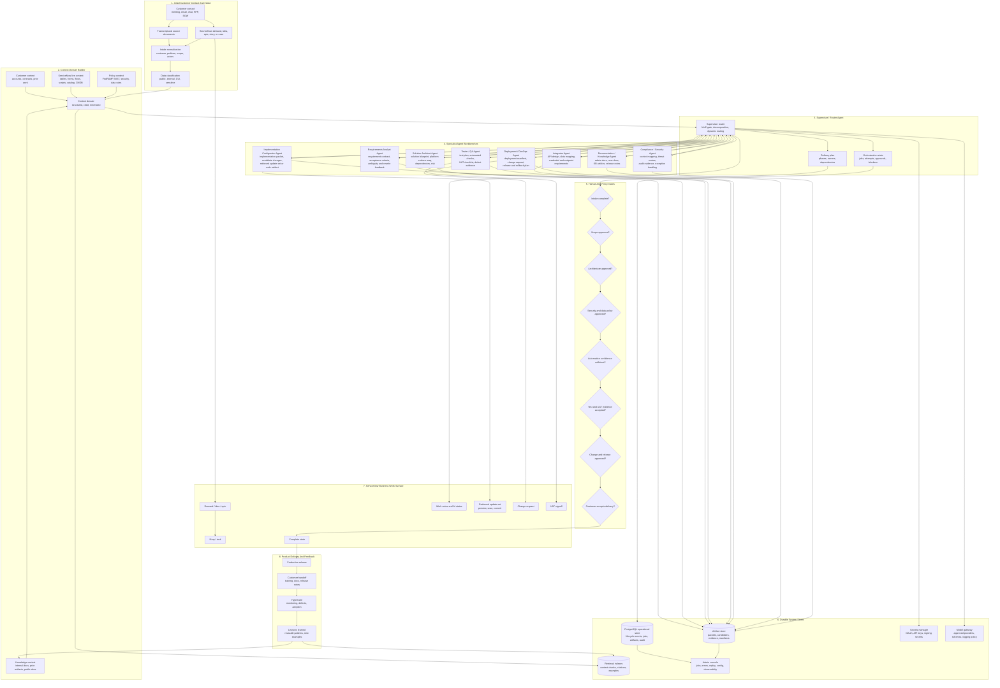

# Product Delivery Orchestration Suite

## Purpose

This document sketches the target data flow for expanding JEDI from a ServiceNow
story fulfillment sidecar into a full product-delivery orchestration suite. The
suite should take work from initial customer contact through structured intake,
solution design, implementation, validation, controlled release, and customer
acceptance.

ServiceNow remains the primary business work surface and system of record for
regulated delivery. The orchestration suite provides the agent runtime, context
dossier, durable artifacts, evidence trail, model gateway, and automation
handoffs around that work surface.

## End-To-End Flow

## Artifact Lifecycle

Every agent should emit structured artifacts. Prose summaries are useful for
humans, but downstream automation should depend on typed contracts.

```mermaid
flowchart LR
    Intake["Raw intake\ntranscripts, docs, ServiceNow records"]
    ReqContract["RequirementContract\nproblem, actors, outcomes,\nacceptance criteria"]
    Blueprint["SolutionBlueprint\nsurfaces, design, dependencies,\nrisk, open questions"]
    Packet["ImplementationPacket\ncontext dossier, allowed changes,\nvalidation contract"]
    Candidate["CandidateChange\nstructured model or deterministic output"]
    Handoff["DeliveryHandoff\nretrieved update set, code artifact,\nconfig artifact, or manual plan"]
    TestEvidence["TestEvidencePackage\nunit, integration, UAT,\ndefects, screenshots"]
    Compliance["ControlAssessment\npolicy mapping, approvals,\nexceptions, audit links"]
    Manifest["DeliveryManifest\nrelease contents, rollback,\ndocs, support owner"]

    Intake --> ReqContract
    ReqContract --> Blueprint
    Blueprint --> Packet
    Packet --> Candidate
    Candidate --> Handoff
    Handoff --> TestEvidence
    TestEvidence --> Compliance
    Compliance --> Manifest
```

## Build Implications

- The supervisor/router coordinates work but should not be the durable system of
  record.
- Each agent boundary needs a typed input and output contract before it becomes
  production automation.
- ServiceNow lifecycle events should continue to drive the regulated business
  workflow.
- The orchestration suite should write useful feedback to the story whenever
  automation cannot proceed, including suggested rewrites when the work can be
  made automatable.
- Deterministic builders remain preferred for mature ServiceNow surfaces.
- LLM-generated candidates should be allowed only when the context dossier,
  policy gate, and validator can explain why the handoff is safe enough for
  human preview.
- Human review remains explicit at architecture approval, security approval,
  retrieved update set preview and commit, UAT, change approval, and final
  customer acceptance.
