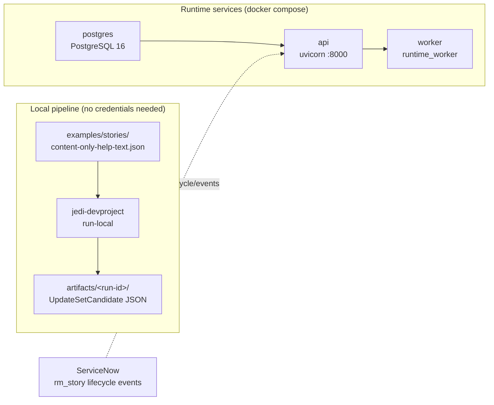

# Quickstart

Get JEDI DevProject installed, verified, and running locally. Everything on this page is
dry-run by default: no ServiceNow mutation and no model call happens unless you explicitly
configure and authorize it.

JEDI DevProject is a FedRAMP-aligned sidecar for ServiceNow. It ingests `rm_story`
lifecycle events, evaluates eligible stories, builds reviewable Update Set candidates,
and writes structured status back to ServiceNow.



## Prerequisites

| Requirement | Version | Needed for |
|---|---|---|
| Python | 3.11 or later | Local install and CLI |
| Docker with Docker Compose | Compose v2 | Containerized runtime and the bundled local PostgreSQL |
| ServiceNow OAuth credentials | PM and/or DEV instance | Live ingestion, writeback, and bootstrap only — not for the local pipeline |

Check what you have:

```bash
python3 --version        # 3.11+
docker compose version   # v2.x
```

## 1. Install

```bash
python3 -m venv .venv && source .venv/bin/activate
pip install -e '.[dev]'
```

This installs the `jedi-devproject` console script (defined in `pyproject.toml` under
`project.scripts`) plus the development toolchain: pytest, coverage, ruff, bandit,
pip-audit, and mypy.

Verify the install:

```bash
jedi-devproject --version
```

Expected output:

```text
jedi-devproject-0 0.2.0
```

## 2. Configure `.env`

```bash
cp .env.example .env
```

`.env` holds local credentials and runtime controls. Never commit it — the Docker build
context excludes `.env*`, and the loader enforces strict parsing (no duplicate keys, no
symlinks, 1 MiB maximum).

Minimum values for the containerized runtime:

| Setting | Purpose | Requirement |
|---|---|---|
| `JEDI_POSTGRES_PASSWORD` | Password for the compose PostgreSQL service. Interpolated into `POSTGRES_PASSWORD` and `DATABASE_URL`. | Required by `docker compose up`; compose aborts with `JEDI_POSTGRES_PASSWORD_required` when unset. |
| `SERVICENOW_PM_INSTANCE_URL`, `SERVICENOW_PM_CLIENT_ID`, `SERVICENOW_PM_CLIENT_SECRET` | PM/source instance OAuth client. Owns story reads and story writeback. | Required by the compose `api` and `worker` services. HTTPS instance URL without embedded credentials. |
| `SERVICENOW_DEV_INSTANCE_URL`, `SERVICENOW_DEV_CLIENT_ID`, `SERVICENOW_DEV_CLIENT_SECRET` | DEV/target instance OAuth client. Owns context retrieval and Update Set import. | Required by the compose `api` and `worker` services. |
| `SERVICENOW_INSTANCE_URL`, `SERVICENOW_CLIENT_ID`, `SERVICENOW_CLIENT_SECRET` | Legacy single-instance fallback, used only when the PM/DEV split values are absent. | Optional. |
| `DATABASE_URL` | PostgreSQL DSN for the operational store (events, jobs, artifact blobs). | Required for local-process runtime and `init-operational-store`. Compose sets it automatically for containers. For local processes, point it at your own PostgreSQL, e.g. `postgresql://jedi:<password>@localhost:5432/jedi`; note the compose `postgres` service publishes no host port by default. |
| `JEDI_AUDIT_ROOT` | Directory for local audit artifacts. | Required for the runtime; `artifacts/audit` is the template default. |

Safety-relevant defaults (leave these alone for a first run):

| Setting | Default | Effect |
|---|---|---|
| `JEDI_ENVIRONMENT` | `development` | Development mode skips the production fail-closed checks. |
| `JEDI_RUNTIME_ROLE` | `combined` | One process serves API and worker. Compose overrides this to split `api`/`worker` roles. |
| `JEDI_BUILD_CLAIM_APPLY` | `false` | Story claim writeback stays dry-run. |
| `JEDI_UPDATE_SET_APPLY` | `false` | Update Set import calls stay dry-run. |
| `JEDI_MODEL_PROVIDER` | empty | No model provider calls. `openai` additionally requires `OPENAI_API_KEY` and `OPENAI_MODEL`. |
| `JEDI_LIFECYCLE_WEBHOOK_AUTH_MODE` | `disabled` | Webhook authentication off. Set `hmac_sha256` with `JEDI_LIFECYCLE_WEBHOOK_SECRET` before exposing the API beyond localhost. |
| `JEDI_ADMIN_AUTH_MODE` | `disabled` | Admin console auth off; the JSON admin diagnostic routes require `JEDI_ADMIN_API_TOKEN` regardless. |

The full configuration reference — rate limits, payload bounds, alert delivery, public
documentation retrieval, and the production fail-closed checklist — is in
`docs/operator-guide.md`.

## 3. Run the Local Pipeline

Process the bundled example story end to end. This path is fully local: it needs no
ServiceNow instance, no database, and no model provider.

```bash
jedi-devproject run-local \
  --sample-file examples/stories/content-only-help-text.json \
  --artifact-root artifacts \
  --run-id first-run
```

Expected output (single summary line):

```text
run_id=first-run stories_processed=1 eligible=1 manual_review=0 rejected=0 generated_candidates=1 artifact_count=1 enriched_stories=0 enrichment_manual_review=0 inferred_tables=0 automated_development_candidates=1
```

The command exits `0` and writes one `UpdateSetCandidate` JSON artifact to
`artifacts/first-run/STORY-EXAMPLE-001.json`. Review that file before anything moves
toward an instance — human review is a hard gate, not a formality.

Artifacts are write-once. Re-running with the same `--run-id` fails with
`ArtifactWriteError: artifact already exists`. Pick a fresh run ID for each run.

## 4. Start the Runtime with Docker Compose

The runtime receives ServiceNow lifecycle webhooks and fulfills them asynchronously.
Compose starts three services:

| Service | Image / command | Role |
|---|---|---|
| `postgres` | `postgres:16` (digest-pinned) | Operational store. Healthchecked with `pg_isready`. |
| `api` | `Dockerfile`; `uvicorn jedi_devproject.runtime_api:build_app --factory --host 0.0.0.0 --port 8000` | Lifecycle webhook intake, readiness, admin diagnostics. Bound to `127.0.0.1:8000` only. |
| `worker` | `Dockerfile.worker`; `python -m jedi_devproject.runtime_worker` | Claims and fulfills queued jobs. Starts only after `api` is healthy. |

All containers run with `no-new-privileges`, dropped capabilities, read-only root
filesystems, and bounded JSON logs.

```bash
docker compose up --build
```

Compose reads `.env` automatically for variable interpolation and fails fast with a
`<NAME>_required` error when any of the seven required values (see step 2) is missing.

Watch startup:

```bash
docker compose ps        # wait for postgres and api to report healthy
docker compose logs -f api
```

To stop and remove the stack, including the database volume:

```bash
docker compose down -v
```

## 5. Initialize the Operational Store

The operational store schema (lifecycle events, fulfillment jobs, artifact blobs, and
related tables) is applied from the SQL migrations bundled in
`jedi_devproject/migrations/`. Connecting through `connect_operational_store()` applies
pending migrations, so the compose `api` service initializes the schema at startup. For
local processes or a standalone PostgreSQL, initialize and verify explicitly:

```bash
jedi-devproject init-operational-store
```

Expected output, exit code `0`:

```text
operational_store_schema_ready=true
```

The command reads `DATABASE_URL` from `.env` (override with `--env-file`). When required
tables are missing it prints `operational_store_schema_ready=false` and exits `1`; when
`.env` lacks required settings it raises `RuntimeConfigError: Missing required runtime
settings: ...` listing the absent keys.

## 6. Verify Health

The API exposes two unauthenticated probes:

| Endpoint | Purpose | Success |
|---|---|---|
| `GET /health` | Process liveness. No dependency checks. | `200 {"status":"ok"}` |
| `GET /ready` | Readiness. Verifies the operational store connection and schema. | `200 {"status":"ready","checks":[{"name":"operational_store","status":"ok"}]}` |

```bash
curl -s http://127.0.0.1:8000/health
curl -s http://127.0.0.1:8000/ready
```

`/ready` returns `503` with `{"status":"unready","checks":[{"name":"operational_store","status":"failed"}]}`
when the database is unreachable, and `503` with `"name":"operational_store_schema","status":"missing"`
when the schema has not been initialized. Every response carries an
`X-JEDI-Request-ID` header for log correlation.

With the API running and admin auth configured, the read-only operator console is at
`http://127.0.0.1:8000/admin`. The full endpoint inventory, including the authenticated
lifecycle webhook and artifact retrieval routes, is in `docs/system-architecture.md`
under "Runtime Components" and in `docs/operator-guide.md`.

## Troubleshooting

| Symptom | Cause | Fix |
|---|---|---|
| `docker compose up` aborts with `JEDI_POSTGRES_PASSWORD_required` (or another `<NAME>_required`) | Required interpolation variable missing from `.env`/environment. | Set the value in `.env` (step 2) and re-run. |
| `api` logs `FATAL: password authentication failed for user "jedi"` | The `postgres-data` volume was initialized with a different `JEDI_POSTGRES_PASSWORD`; PostgreSQL only applies `POSTGRES_PASSWORD` on first init. | `docker compose down -v` to recreate the volume, then `docker compose up --build`. This destroys local operational data. |
| `init-operational-store` or `/ready` fails with `psycopg.errors.InvalidTextRepresentation: malformed array literal` | Known defect in `verify_schema_ready()` (`src/jedi_devproject/operational_store.py`): the required-table tuple is bound as a record literal instead of an array. Unit tests use a stubbed connection, so CI does not catch it. | Code fix required (bind a list, or use `= ANY(ARRAY[...])` with an explicit cast). Until fixed, `/ready` reports `operational_store: failed` against a real PostgreSQL even when the schema is present. |
| `run-local` fails with `ArtifactWriteError: artifact already exists` | Artifacts are write-once; the `--run-id` directory already contains output. | Use a new `--run-id`, or remove the old artifact directory. |
| `RuntimeConfigError: Missing required runtime settings: DATABASE_URL, ...` | A command that loads `.env` (anything touching the database or ServiceNow) cannot find required keys. | Fill in `.env` from step 2, or pass `--env-file` pointing at a complete file. |
| `FileNotFoundError` on `--sample-file` | Relative path resolved from a different working directory. | Run from the repository root or pass an absolute path. |
| Port `8000` already in use | Another process bound to `127.0.0.1:8000`. | Stop the other process, or change the `ports` mapping in `docker-compose.yml`. |

## Next Steps

- `examples/README.md` — CLI cookbook: runnable command sequences, expected outputs, and failure modes.
- `docs/system-architecture.md` — components, trust boundaries, workflows, and data flows.
- `docs/operator-guide.md` — configuration reference, ServiceNow-side bootstrap, smoke testing, and the production fail-closed checklist.
- `docs/development.md` — test-first rules and the coverage gate for contributors.
- `README.md` — objectives, compliance posture, and roadmap.
