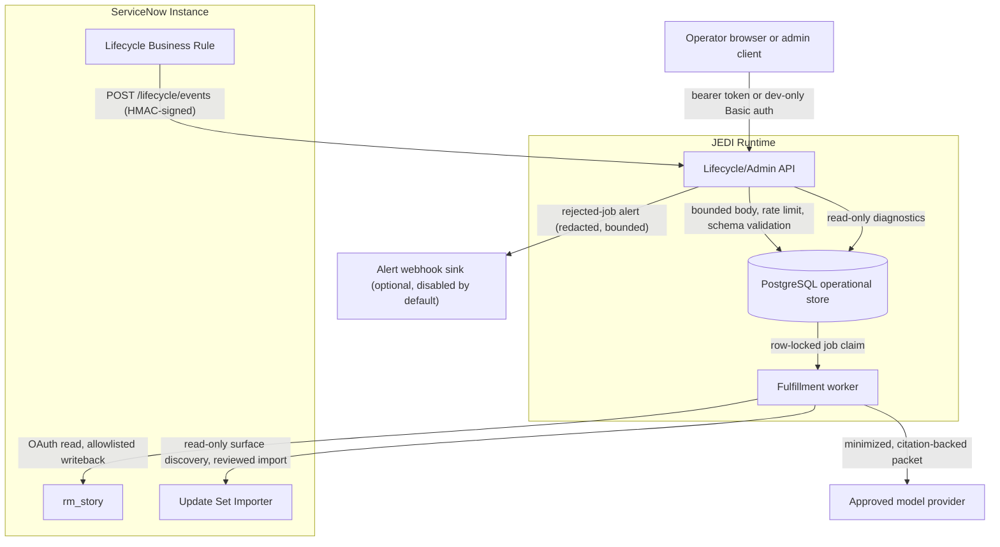

# Data Flow

The canonical architecture and diagram set is `docs/system-architecture.md`. This file keeps the
security-focused data-flow summary: where regulated data moves, which control guards each
crossing, and where redaction applies.

## Security Data Flow

## Flow Stages and Controls

1. **Event emission (ServiceNow).** The lifecycle Business Rule emits a state-change event for
   `rm_story`. Signed calls carry `X-JEDI-Webhook-Timestamp` and `X-JEDI-Webhook-Signature`
   (`sha256=<hex hmac>` or `sha256-base64=<base64 hmac>` from ServiceNow `generateMac()`).
2. **Ingress control (API).** The receiver enforces the streaming body cap (default 64 KiB),
   applies the per-process rate limit, verifies the HMAC signature and timestamp replay window,
   and validates the payload against the strict `LifecycleStateChangeEvent` schema. Validation
   errors omit submitted input values. Webhook requests are ingestion only; no fulfillment runs
   inline.
3. **Operational persistence (PostgreSQL).** Events land in `lifecycle_events` with their raw
   payload and validation status; eligible events enqueue one `fulfillment_jobs` row. All queries
   are parameterized; `job_events` is append-only; `artifact_refs` records SHA-256 hashes for
   persisted artifacts. These tables are the durable audit trail.
4. **Worker claim and story retrieval (PM instance).** A worker claims a queued job with a row
   lock, then reads the story by `story_sys_id` through the Table API using the PM OAuth client.
   Outbound calls never follow redirects, so bearer tokens cannot leak off the configured host.
5. **Context retrieval (DEV instance).** The worker retrieves live surface context (table schema,
   form layout, scripts, policies, flows, catalog, CMDB IRE) through read-only Table API calls on
   the DEV client. Script-like fields and integration endpoint query strings are redacted before
   model-facing artifacts; sys_ids are minimized.
6. **Model call (provider boundary).** The worker builds the implementation packet — minimized
   story fields, safety decision, allowlisted tables and operations, citation-backed context — and
   calls a provider only when runtime configuration, provider policy, data classification, context
   sufficiency, and capability maturity all allow it. The response is strict structured JSON;
   raw XML output fails closed. The default policy approves only the local rules-only provider.
7. **Artifact storage.** Packets, dossiers, candidates, intake feedback, and ATF test plans are
   stored as `artifact_blobs` with `artifact_refs` hashes. Artifacts are retained after failures
   for audit and root-cause analysis.
8. **Controlled writeback (PM instance).** Writeback is limited to allowlisted `rm_story` fields,
   work notes, and discovered state transitions. Work-note text is redacted, normalized, and
   capped before writing. `JEDI_BUILD_CLAIM_APPLY` and `JEDI_UPDATE_SET_APPLY` default to `false`.
9. **Retrieved Update Set handoff (DEV instance).** Only mature deterministic builders produce
   retrieved Update Set XML, imported through the reviewed ServiceNow-side importer into
   `sys_remote_update_set`. Human preview, scan, collision resolution, and commit remain in
   ServiceNow.
10. **Admin diagnostics.** JSON admin and artifact endpoints require the
    `JEDI_ADMIN_API_TOKEN` bearer credential; the HTML console requires `dev_basic` credentials in
    development only. Admin artifact views recursively redact sensitive keys and bound payload
    depth, item count, and size; diagnostic responses are marked `no-store`.
11. **Alert egress (optional).** Rejected-job alerts are delivered only when
    `JEDI_ALERT_WEBHOOK_ENABLED=true`, to an HTTPS URL that passes SSRF validation (no
    credentials, no local or link-local targets, no sensitive query parameters), with bounded
    body and timeout. Delivery failure is logged redacted and never blocks processing.

## Redaction Points

| Surface | Control |
|---|---|
| Handler exceptions and runtime logs | Literal configured secrets replaced with `***REDACTED***` (`runtime_redaction.py`). |
| Diagnostic strings (logs, API errors, work notes) | URL credentials, sensitive query keys, `Authorization` values, cookies, PEM keys, and sensitive assignments redacted (`diagnostic_redaction.py`, `sensitive_keys.py`). |
| ServiceNow work notes | Values redacted, whitespace-normalized, capped at 500 chars (`work_note_safety.py`). |
| Admin artifact payloads | Sensitive keys recursively replaced; depth, breadth, and size bounded (`admin_routes.py`). |
| Model-facing packets and dossiers | Script-like fields redacted, sys_ids minimized, endpoint query strings redacted. |
| Webhook validation errors | Pydantic `input` values omitted; parser exceptions not chained into public errors. |
| Health/readiness probes | `GET /ready` returns check names only — no exception text, SQL, URLs, or credentials. |

## Local Development Flow

Local development uses the same components with relaxed startup validation
(`JEDI_ENVIRONMENT=development`):

1. Developer stores PDI connection settings in a local `.env` (git-ignored).
2. `OAuthClientCredentials` requests a token from the PDI over HTTPS.
3. `ServiceNowClient` makes Table API requests with the least-privilege PDI account.
4. The pipeline classifies, retrieves context, builds packets, and generates candidates under the
   same gates as the hosted runtime.
5. Tests use fake transports and synthetic records by default; live PDI calls are manual smoke
   tests only.

Data-handling rules for local work are in `docs/policies/local-regulated-data.md`.

## Prohibited Flows

- No data may flow to a public model endpoint unless an approved Federal authorization path,
  provider policy, data-class allowance, and task allowance exist.
- No lifecycle webhook reaches fulfillment without passing the configured auth mode; unconfigured
  auth fails closed with `503`.
- No model response may emit raw XML or tables/operations outside the allowlist.
- No ServiceNow mutation outside the allowlisted story writeback and the reviewed retrieved
  Update Set importer path.
- No secrets, OAuth tokens, or raw sensitive story content in logs, work notes, admin responses,
  artifacts, prompts, or fixtures.
