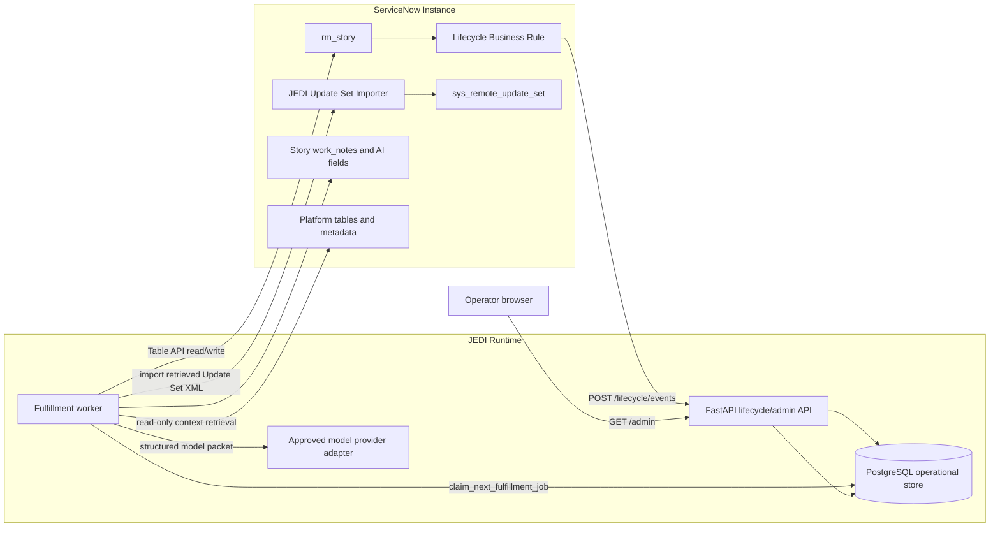
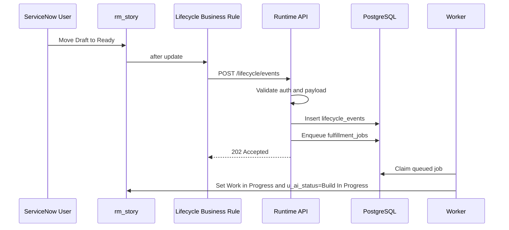
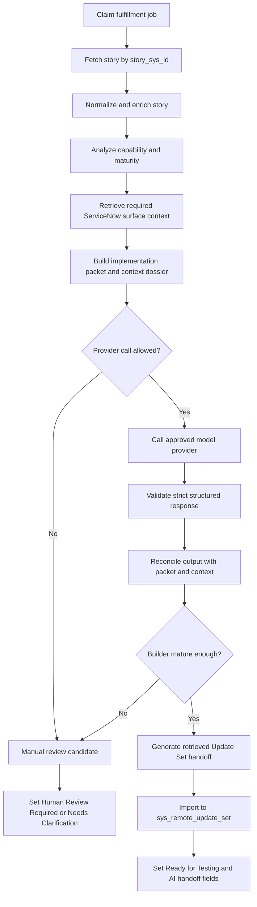
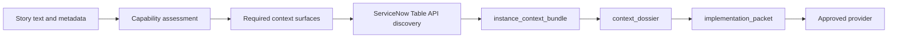
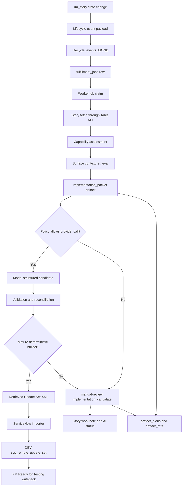
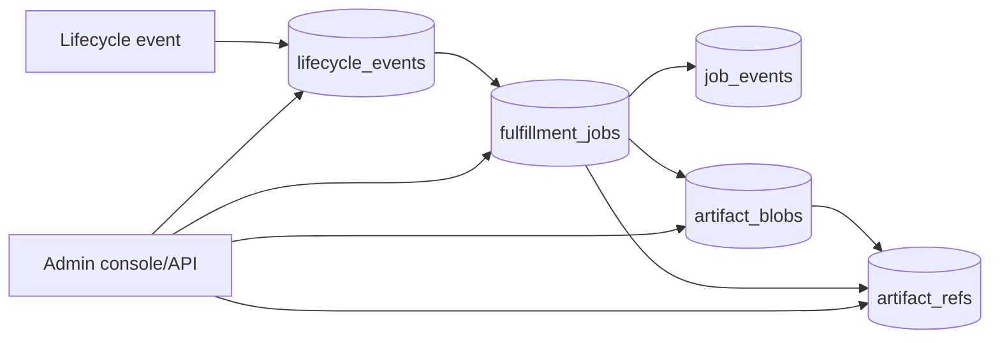
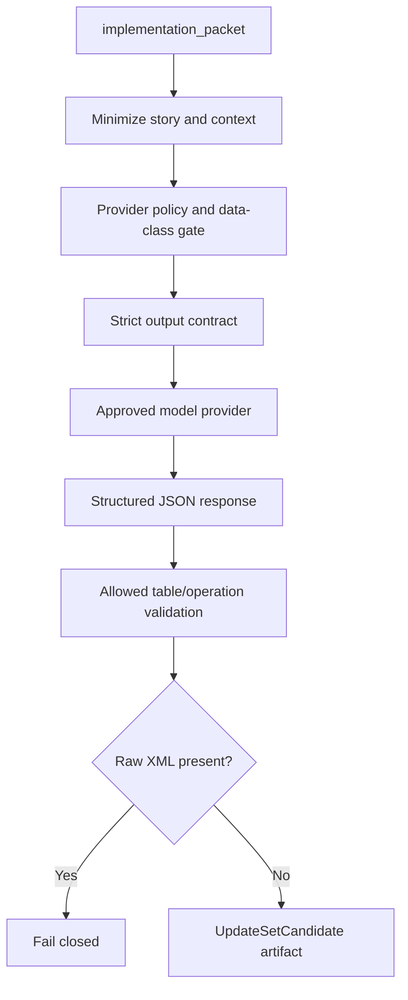
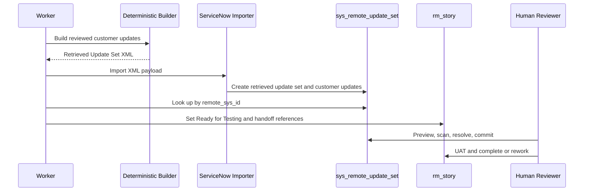
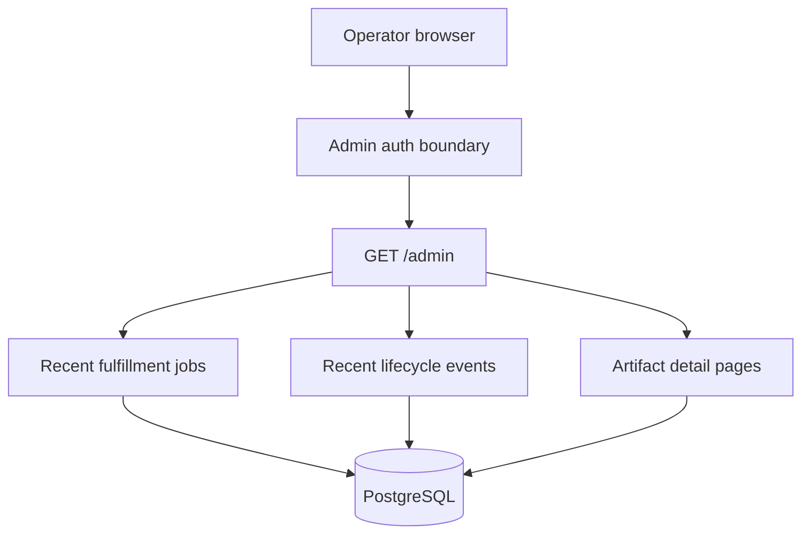

# System Architecture

## Purpose

JEDI DevProject is a ServiceNow sidecar runtime for regulated AI-assisted delivery. ServiceNow remains the user work surface and workflow system of record. The sidecar receives lifecycle events, evaluates stories, retrieves live instance context, builds implementation packets, calls an approved model provider only when policy allows, stores durable artifacts, and writes status back to the ServiceNow story.

The system does not auto-commit Update Sets. The human review point is ServiceNow Retrieved Update Set preview, scan, collision resolution, and commit.

## Architectural Principles

- ServiceNow is the canonical work surface.
- `story_sys_id` is the authoritative story identifier when available; `number` is only a display and legacy fallback.
- Webhook requests are ingestion only. Fulfillment runs asynchronously in worker processes.
- PostgreSQL is the operational source of truth for events, jobs, and artifacts.
- Rules are gates, not the implementation engine.
- Model output is structured candidate data, not raw XML.
- Retrieved Update Set handoff is enabled only for mature deterministic builders.
- Context-only and immature surfaces route to human review.
- Every failure writes back to ServiceNow work notes when the story can be resolved.

## Runtime Components

| Component | Code Boundary | Responsibility |
|---|---|---|
| ServiceNow lifecycle emitter | Bootstrap Business Rule and Scripted REST resources | Emits lifecycle events when stories move through the configured workflow. |
| Runtime API | `create_runtime_api`, `create_lifecycle_api` | Receives lifecycle events, authenticates requests, rate-limits, persists events, and enqueues fulfillment jobs. |
| Operational store | `operational_store.py`, `db/migrations/0001_operational_store.sql` | Stores lifecycle events, fulfillment jobs, job events, artifact blobs, and artifact refs. |
| Fulfillment worker | `runtime_worker.py`, `fulfillment_worker.py` | Claims queued jobs with row locks and executes fulfillment outside the webhook request. |
| Build claim handler | `fulfillment_handler.py` | Moves eligible stories from Ready to Work in Progress when configured. |
| Model fulfillment handler | `model_fulfillment.py` | Retrieves story context, builds packets, calls provider, stores candidate artifacts, and creates handoff if allowed. |
| Capability analyzer | `capability_analysis.py`, `capabilities.py` | Classifies story capability, maturity, required context, and automation outcome. |
| Instance discovery | `instance_discovery.py` | Retrieves live ServiceNow surface context through read-only Table API calls. |
| Implementation packet builder | `implementation_packet.py` | Produces model-ready packet, context dossier, sufficiency report, and validated candidate. |
| Deterministic builders | `generic_dictionary_form.py`, generation modules, handoff modules | Convert approved structured candidates into ServiceNow-reviewed artifacts for mature surfaces. |
| Update Set importer | ServiceNow-side importer endpoint | Imports retrieved Update Set XML into `sys_remote_update_set` for human preview and commit. |
| Admin console | `runtime.py` | Read-only operator view over recent jobs, events, and artifacts. |

## Deployment Topology

## Trust Boundaries

| Boundary | Crosses From | Crosses To | Controls |
|---|---|---|---|
| ServiceNow to API | Lifecycle Business Rule | Runtime API | HMAC webhook authentication, timestamp replay window, payload schema validation, rate limit. |
| API to PostgreSQL | Runtime API | Operational store | Parameterized SQL, transaction boundaries, immutable event payload preservation. |
| Worker to PM ServiceNow | Worker process | Story/source ServiceNow instance | `SERVICENOW_PM_*` OAuth credentials, allowlisted `rm_story` fields, discovered story state choices, Table API lookup by `story_sys_id`. |
| Worker to DEV ServiceNow | Worker process | Development target ServiceNow instance | `SERVICENOW_DEV_*` OAuth credentials, read-only surface discovery, reviewed importer endpoint, retrieved Update Set handoff only for mature builders. |
| Worker to model provider | Worker process | Approved provider endpoint | Provider policy, data classification, minimal packet, strict JSON schema, no raw XML output. |
| Admin browser to API | Operator | Runtime admin routes | Development Basic auth or future approved OIDC/ServiceNow OAuth, read-only routes. |

## Lifecycle Workflow

### Draft To Ready

When a user moves a story from Draft to Ready, ServiceNow emits a lifecycle event. The API records the event and queues one job. The worker later claims the job, moves the story to Work in Progress when claim writeback is enabled, and runs the fulfillment pipeline.

### Fulfillment Pipeline

## Capability Routing

| Capability | Current Runtime Outcome | Required Context | Handoff |
|---|---|---|---|
| `dictionary_field_create` / `form_layout_place_field` | Automated build for low-complexity stories | `table_schema`, `form_layout` | Retrieved Update Set. |
| `form_section_remove` | Candidate generation | `form_sections`, `form_layout` | No handoff until deterministic section XML evidence is restored. |
| `catalog_item_create` | Candidate generation | Catalog, category, Employee Center topic, connected content | No handoff until catalog builder maturity reaches the handoff threshold. |
| `business_rule_generate` | Candidate generation | `table_schema`, `business_rules` | No handoff until executable-code XML evidence and validators are approved. |
| `client_script_generate` | Candidate generation | `table_schema`, `client_scripts` | No handoff until browser-side safety and XML evidence are approved. |
| `script_include_generate` | Candidate generation | `script_includes` | No handoff until executable-code XML evidence and validators are approved. |
| `ui_policy_generate` | Supported declarative subset | `table_schema`, `form_layout`, `ui_policies` | Retrieved Update Set for validated actions. |
| `flow_modify` | Context/preflight only | `flows`, `flow_graph` | No handoff. |
| `cmdb_ire_analyze` / `cmdb_ire_generate` | Analysis and candidate generation | IRE rules, data sources, class hierarchy | No handoff until CMDB IRE XML shape evidence exists. |
| Unknown, unsupported, high-risk, or missing details | Clarification or human review | Varies | No handoff. |

## Live Context Dossier

The worker builds a context dossier before model generation. The dossier is the model-facing source of truth for what the instance currently contains.

Context surfaces include:

- Table schema from `sys_dictionary`.
- Form layout and sections from `sys_ui_section` and `sys_ui_element`.
- Business Rules from `sys_script`.
- Client Scripts from `sys_script_client`.
- UI Policies from `sys_ui_policy`.
- Script Includes from `sys_script_include`.
- Flow Designer graph context from approved `sys_hub_*` records.
- Catalog and Employee Center context from catalog, category, taxonomy, topic, and connected-content tables.
- CMDB IRE context from `cmdb_identifier`, `cmdb_identifier_entry`, `cmdb_reconciliation_definition`, `sys_object_source`, and CMDB class hierarchy records.
- Integration surface metadata with endpoint query strings redacted.
- Approved public-documentation RAG query references.

Script-like fields and conditions are redacted before model-facing artifacts. ServiceNow sys_ids are minimized unless needed for internal deterministic resolution.

## Data Flow

### End-To-End Data Flow

### PostgreSQL Operational Data Flow

Operational records are durable audit evidence:

- `lifecycle_events` preserves inbound event payloads and validation status.
- `fulfillment_jobs` preserves queue, claim, retry, terminal status, lock metadata, and failure text.
- `job_events` records append-only state changes.
- `artifact_blobs` stores implementation packets, context bundles, candidate artifacts, and analysis artifacts.
- `artifact_refs` links persisted artifacts to jobs with SHA-256 hashes.

### Model Data Flow

Provider calls are disabled unless runtime configuration, provider policy, data classification, context sufficiency, and capability maturity allow them. `JEDI_CLASSIFIER_GATE=false` is a development control for exploratory structured reasoning; it does not authorize retrieved Update Set handoff for non-automated classifier outcomes. Capability status uses `enabled` only for builders that can create retrieved Update Set handoff artifacts now; lower maturity builders use `candidate_generation`, `context_only`, or `designed`.

### Retrieved Update Set Handoff Flow

## State And Status Model

## Split ServiceNow Instances

Runtime ServiceNow access is split by responsibility:

- PM/source instance: `SERVICENOW_PM_INSTANCE_URL`, `SERVICENOW_PM_CLIENT_ID`, and `SERVICENOW_PM_CLIENT_SECRET`.
- DEV/target instance: `SERVICENOW_DEV_INSTANCE_URL`, `SERVICENOW_DEV_CLIENT_ID`, and `SERVICENOW_DEV_CLIENT_SECRET`.

The PM client owns story retrieval and story writeback. It reads `rm_story`, story state choices, and story dictionary metadata, then writes story AI status, work notes, and lifecycle state transitions.

The DEV client owns development context and generated platform artifacts. It retrieves target table/form/code/catalog/CMDB context, resolves platform metadata, and imports reviewed retrieved Update Set XML through the ServiceNow-side importer.

The legacy `SERVICENOW_INSTANCE_URL`, `SERVICENOW_CLIENT_ID`, and `SERVICENOW_CLIENT_SECRET` settings remain only as a single-instance compatibility fallback.

| ServiceNow State Change | Runtime Action | Story AI Status |
|---|---|---|
| Draft to Ready | Queue fulfillment job. | Build In Progress after worker claim. |
| Ready to Work in Progress | Worker claim writeback when enabled. | Build In Progress. |
| Handoff created | Retrieved Update Set is available for preview/commit. | Ready for Testing. |
| Candidate manual review | No retrieved Update Set. | Human Review Required or Needs Clarification. |
| Fulfillment failure | Failure work note and Draft rollback when state choice exists. | Automation Failed. |
| Ready for Testing to Ready | Record rework request; do not enqueue a new build. | Ready for Testing unless a later sprint changes it. |
| Ready for Testing to Draft | Mark latest job rejected; preserve artifacts. | Human-driven story rejection path. |
| Ready for Testing to Complete | Record completion event. | Complete. |

## Failure Handling

Failure handling is deliberately visible in ServiceNow:

1. Runtime catches handler failures at worker boundary.
2. Worker records failed job state and `last_error`.
3. Failure notifier resolves the story by `story_sys_id` when possible.
4. Failure notifier writes a work note with lifecycle event id, job id, and error text.
5. If the active Draft state choice is discoverable, the story returns to Draft and `u_ai_status=Automation Failed`.

The process does not delete artifacts after failures. Artifacts are retained for audit and root-cause analysis.

## Admin Console Flow

The admin console is read-only. It is an operator diagnostic surface, not the business work surface. It does not provide retry, approve, reject, preview, commit, or rebuild actions.

## Bootstrap Infrastructure

Bootstrap installs or updates the ServiceNow-side infrastructure required for lifecycle events and handoff:

- Automation metadata fields on `rm_story`.
- Read-only form policy for AI metadata fields while preserving Table API writeability.
- Lifecycle Business Rule on `rm_story`.
- Scripted REST or importer resources required by the runtime.
- Endpoint configuration for the runtime URL.

Bootstrap should be treated as controlled platform configuration and reviewed like any other ServiceNow update.

## Security And Compliance Notes

- Public model endpoints are prohibited unless explicitly approved for the data category and authorization boundary.
- Runtime secrets belong in the hosting environment, not source control or artifacts.
- Logs and work notes must not include OAuth tokens, client secrets, API keys, or raw sensitive story content.
- Model-facing payloads must use minimized, citation-backed context.
- Raw XML from the model is rejected; XML generation belongs to deterministic builders.
- Production admin auth must move from development Basic auth to approved OIDC or ServiceNow OAuth once implemented.

## Current Gaps

- Production role-backed admin authentication is reserved but not implemented.
- Several ServiceNow surfaces remain context-only or design-only.
- Flow Designer and CMDB IRE retrieved Update Set mutation builders are not approved.
- Public documentation retrieval can be enabled for the worker with `JEDI_PUBLIC_WEB_ACCESS=worker`; it is allowlist-only, HTTPS-only, bounded, cited, hash-backed, and fail-closed before model invocation when required public docs cannot be fetched.
- Production deployment still needs customer boundary review for hosting, logs, database, secrets, and model provider.
