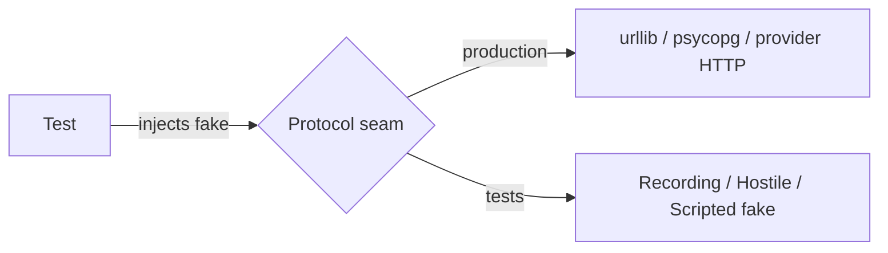

# Testing Guide

This guide covers how the JEDI DevProject test suite is organized, how to run it, and
how to write tests that pass the project's gates. The gates are enforced, not advisory:
test-first is policy (ADR 0001), coverage is a hard 90% branch gate, and mypy `strict`
checks the tests themselves.

## Test Organization

- All tests live in `tests/` as a **flat** set of `test_<module>.py` files, one per
  source module in `src/jedi_devproject/` (for example, `writeback.py` is covered by
  `tests/test_writeback.py`).
- pytest is configured in `pyproject.toml`: `testpaths = ["tests"]` and
  `pythonpath = ["src"]`, so tests import the package directly from `src`.
- There is **no `conftest.py` and no shared fixture library — deliberately**. Each test
  file is self-contained. Do not add `conftest.py`, `@pytest.fixture` decorators, or a
  shared helpers module; copy the local idiom from a neighboring test file instead.
- Tests are pure unit/integration-style tests over in-process fakes. No network, no
  Docker, no live PostgreSQL, no real ServiceNow instance, and no real model endpoint
  anywhere in the suite.
- Some tests guard documentation and packaging rather than code:
  `tests/test_quality_gate.py` asserts the coverage gate and command wiring in
  `pyproject.toml`; `tests/test_project_docs.py` asserts exact substrings of the docs;
  `tests/test_container_runtime.py` asserts exact substrings of the Docker files.

## Fixtures and Test Data

Fixtures are local to each test file:

- Module-level builder functions construct valid inputs, for example `_settings()`,
  `_payload()`, and `_candidate()` in `tests/test_openai_provider.py` and
  `_story(*, ...)` builders in pipeline and safety tests. Builders use keyword-only
  arguments and produce objects that satisfy the strict Pydantic models.
- Hand-written fake classes implement the structural `Protocol` seams:
  `Recording*` fakes capture requests, `Hostile*` fakes return malformed responses to
  exercise fail-closed paths, and `Scripted*` fakes replay canned rows.
- Standard pytest fixtures come from pytest itself: `tmp_path: Path` for artifact
  output and `monkeypatch: pytest.MonkeyPatch` for environment variables and module
  substitution. Because mypy strict checks `tests/`, annotate fixture parameters with
  their types.
- `pytest.mark.parametrize` drives matrix tests over hostile inputs (encoded control
  characters, oversized values, wrong types), which is the standard pattern for
  validation boundaries.

Never put real secrets, credentials, tokens, customer URLs, or regulated data in test
data. Use fake values only (`"openai-key"`, `https://api.openai.example.gov/...`), and
keep the redaction assertions (`safe_summary()` tests are the model) intact.

## Mocking ServiceNow and Model Providers

The codebase has no SDKs; all I/O goes through injectable `Protocol` seams, and tests
fake at those seams. Do not patch HTTP libraries globally when a transport seam exists.



The established seams and their fakes:

| Boundary | Seam | Test fake (example) |
|---|---|---|
| ServiceNow Table API | `HttpTransport.send(HttpRequest) -> HttpResponse` | `RecordingTransport`, `HostileTransport` in `tests/test_servicenow.py` |
| Raw URL fetches | `urllib.request.urlopen` | `FakeUrlResponse*` context managers in `tests/test_servicenow.py` |
| OpenAI / Anthropic providers | same transport Protocol | `RecordingTransport`, `HostileResponseTransport` in `tests/test_openai_provider.py`, `tests/test_anthropic_provider.py` |
| PostgreSQL operational store | `OperationalConnection` Protocol | `ScriptedPostgresConnection` in `tests/test_operational_store.py` |
| `psycopg` import itself | module import | `monkeypatch.setitem(sys.modules, "psycopg", ...)` stub in `tests/test_operational_store.py` |
| FastAPI runtime/lifecycle API | in-process app | `fastapi.testclient.TestClient` in `tests/test_lifecycle_api.py` |

Conventions when writing fakes:

- `Recording*` fakes append every request to a `requests` list so tests assert exactly
  what would have been sent (method, URL, headers, body) without any network call.
- `Hostile*` fakes return wrong types, out-of-range status codes, or oversized bodies
  to prove the code fails closed with a stable diagnostic instead of leaking or
  crashing. Every safety boundary needs this side tested.
- Fakes are fully typed for mypy strict: annotate all attributes and dunders, for
  example `def __exit__(self, *_args: object) -> None`. Name deliberately unused
  parameters `_args`, `_sql`, and similar.
- Provider adapter tests must cover both the OpenAI and Anthropic adapters when a
  prompt or schema changes — the two adapters must send byte-identical system prompts
  and schemas (a comment in the source marks the coupling). Change both or neither.

## Coverage Requirements

- The gate is **90% branch coverage** (`branch = true` under `tool.coverage.run`,
  `fail_under = 90` under `tool.coverage.report` in `pyproject.toml`), enforced by the
  test command's `--cov-fail-under=90` flag and by CI.
- Branch coverage means both sides of every `if`, every early return, and every
  exception path need a test. The reject / manual-review / eligible loops in
  `tests/test_safety.py` are the model for this.
- Do not game the gate: no new `# pragma: no cover` (exactly one exists in `src`, with
  a justification), no lowering `fail_under`, no assertion-free tests written only to
  touch lines.
- `show_missing = true` and `skip_covered = true` keep the terminal report focused on
  the files that still have uncovered branches.

## Running Tests

Full suite with the coverage gate (the command CI runs):

```bash
python3 -m pytest --cov=jedi_devproject --cov-report=term-missing --cov-fail-under=90
```

Targeted runs while iterating:

```bash
# One file
python3 -m pytest tests/test_safety.py -q

# One test or one parametrized case
python3 -m pytest tests/test_openai_provider.py::test_openai_provider_settings_reject_empty_base_url -q

# Keyword filter across the suite
python3 -m pytest -k writeback -q

# Stop at first failure / rerun last failures
python3 -m pytest -x -q
python3 -m pytest --lf -q
```

Targeted runs skip the coverage flags on purpose: `--cov-fail-under=90` measures the
whole package, so a partial run with coverage enabled will report a failing total even
when the tests pass. Confirm the gate with a full run before committing.

The complete quality gate (lint, security, types, tests) is the verify command in
`docs/development.md`; it must exit 0 before every commit.

## Adding Tests for a New Capability

1. **Write the failing test first** (ADR 0001). No production code before a failing
   test demonstrates the intended behavior.
2. Create `tests/test_<new_module>.py` as a self-contained file: local builders, local
   fakes, full type annotations, `-> None` on every test function.
3. Cover the three outcome classes the codebase uses everywhere: the happy path, the
   deterministic reject path, and the manual-review/blocked path, each with the exact
   reason codes or diagnostics the module emits.
4. Cover the hostile-input boundary: malformed types, out-of-range values, oversized
   payloads, and control characters must fail closed with stable diagnostics.
5. When adding a `Capability` enum member, add a registration self-check test that
   walks the enum and asserts membership in every wiring table, plus a routing test
   that proves a story reaches the new branch and a handoff/manual-route test that
   proves the intended terminal state. The wiring points to grep are
   `capabilities.py`, `capability_routing.py`, `intent_classifier.py`,
   `implementation_packet.py`, `model_fulfillment.py`, `builder_maturity.py`, and
   `update_set_handoff.py`; partial wiring fails silently.
6. When changing documented behavior, update the doc and any text-assertion test that
   pins its text (`tests/test_project_docs.py`, `tests/test_container_runtime.py`) in
   the same commit.
7. Finish with the full verify command, not just the new test file.

## Common Pitfalls

- **Adding `conftest.py` or a fixtures module.** Prohibited by convention; keep each
  test file self-contained and copy the local idiom.
- **Real I/O in tests.** No network, Docker, or live PostgreSQL. Fake at the Protocol
  seam; use the `sys.modules` psycopg stub for store construction and `TestClient` for
  FastAPI apps.
- **Untyped or loosely typed tests.** mypy `strict` checks `tests/`. Every test
  function is `-> None`; fakes annotate every attribute and dunder.
- **Gaming coverage.** Branch coverage is earned with both-sides tests, not pragmas or
  lowered gates. Touching the coverage/lint/mypy gates is an escalation-level change.
- **Hand-typing shared string constants.** Capability values, table names, and surface
  names are compared as raw strings across many modules; import the enum member or
  copy the exact string, then grep for it. A typo disables a branch with no error.
- **Adding a routing branch after the terminal default.** `analyze_story_capabilities`
  ends in a fallthrough; insert new branches before it and add a test that would fail
  if the order broke.
- **Editing docs or Docker files without their paired tests.** Exact-substring
  assertions in `tests/test_project_docs.py` and `tests/test_container_runtime.py`
  will fail; update them in the same commit.
- **Trusting a partial run for the gate.** A targeted pytest run proves behavior, not
  coverage. Only the full suite with `--cov-fail-under=90` proves the gate.
- **Secrets or realistic customer data in fixtures.** Fake values only; redaction
  behavior is asserted by test, and regulated data never enters the repo.
- **Weakening an existing assertion to make a change pass.** Existing assertions may
  encode compliance requirements; if one looks wrong, present the evidence instead of
  relaxing it.
